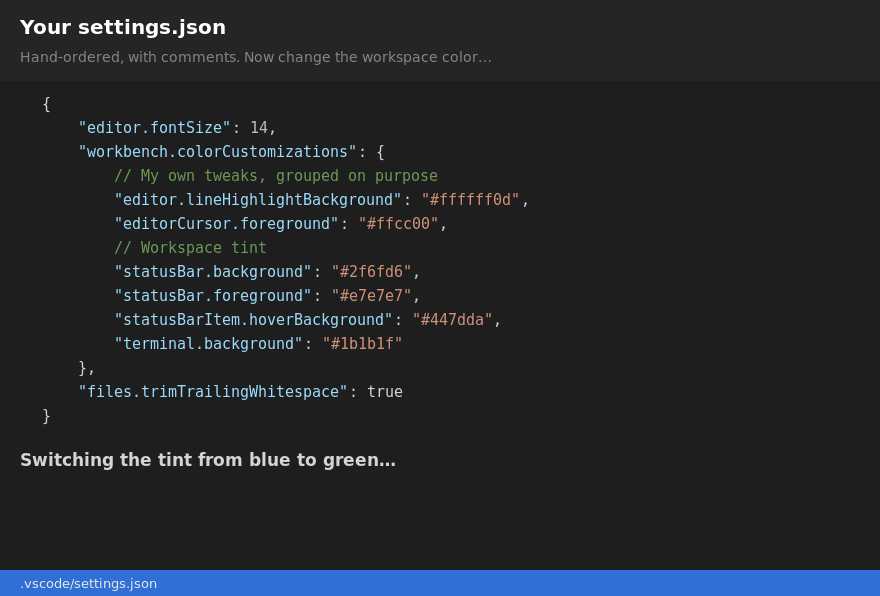

# Tidy Tint

Color your VS Code Activity Bar, Title Bar and Status Bar per workspace, so you
can tell your windows apart at a glance, **without reordering your `settings.json`**.

## Why it doesn't reorder your settings

Extensions usually save colors with `workspace.getConfiguration().update()`,
which replaces the whole `workbench.colorCustomizations` object. Key order (and
any comments inside it) are lost on every change.

Tidy Tint edits the file as text with `jsonc-parser`, one key at a time:

- an existing key gets its value changed **in place**;
- a new key is appended at the end of its object;
- removing colors deletes only Tidy Tint's keys, with their comma and line;
- comments, indentation and line endings elsewhere in the file are left alone;
- edits go through `WorkspaceEdit`, so you can undo them with Ctrl+Z / Cmd+Z.

## Commands

- `Tidy Tint: Change Color` (favorites, hex value or random)
- `Tidy Tint: Random Color`
- `Tidy Tint: Remove Colors`

## Settings

| Setting | Default | Description |
| --- | --- | --- |
| `tidyTint.affectActivityBar` | `true` | Color the Activity Bar |
| `tidyTint.affectTitleBar` | `true` | Color the Title Bar |
| `tidyTint.affectStatusBar` | `true` | Color the Status Bar |
| `tidyTint.favoriteColors` | 8 colors | Colors shown in the picker |

The current color is stored in `tidyTint.color`.

## Notes

- In a multi-root workspace, colors are written to the `.code-workspace` file.
  Save the workspace first.
- Tidy Tint only controls what it writes. Other extensions, or the Settings UI,
  may still rewrite `workbench.colorCustomizations` as a whole.

## Contributing

Issues and pull requests are welcome! See [CONTRIBUTING.md](CONTRIBUTING.md)
to get started, and please follow the [Code of Conduct](CODE_OF_CONDUCT.md).

Found a bug? [Open an issue](https://github.com/cbsumastre/tidy-tint/issues/new/choose).
